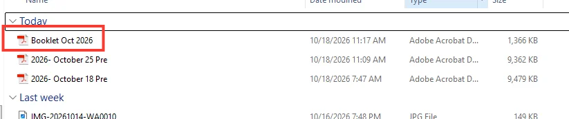
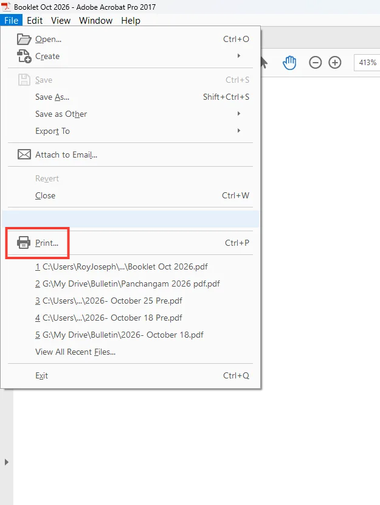
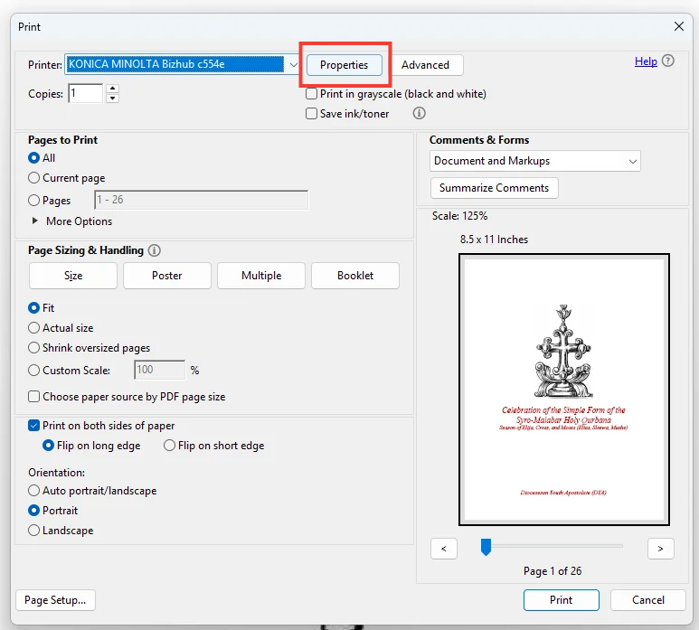
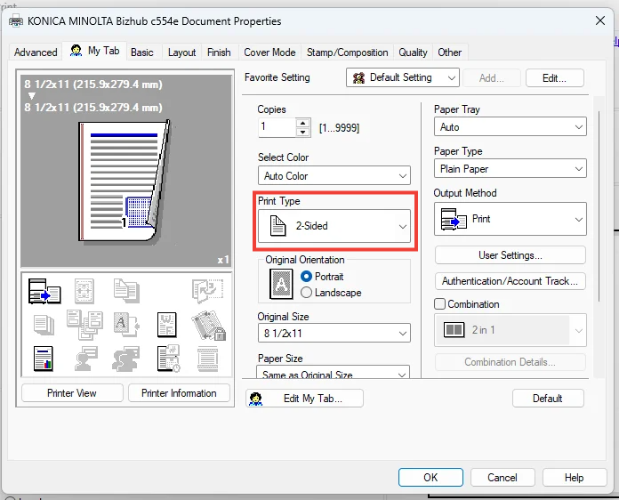
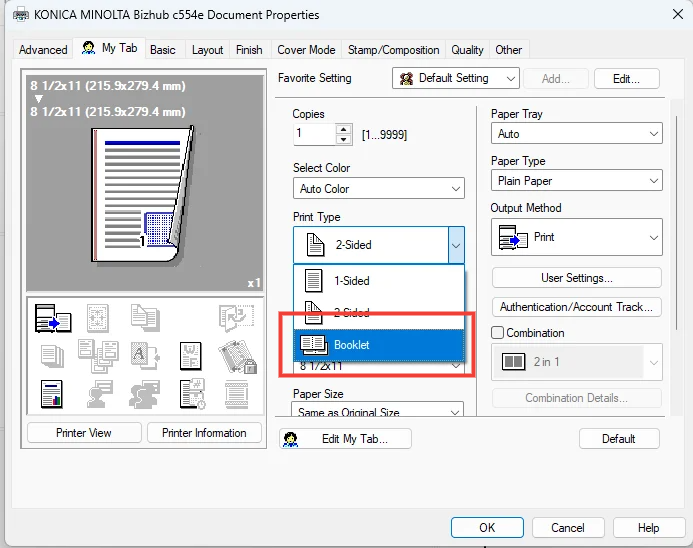
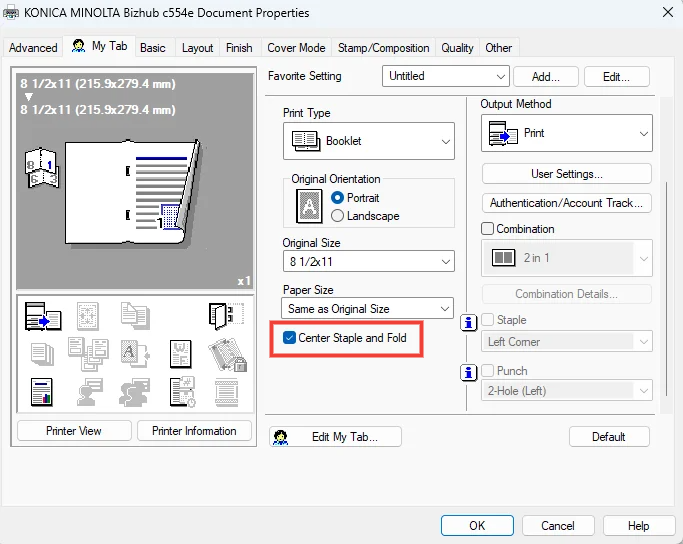
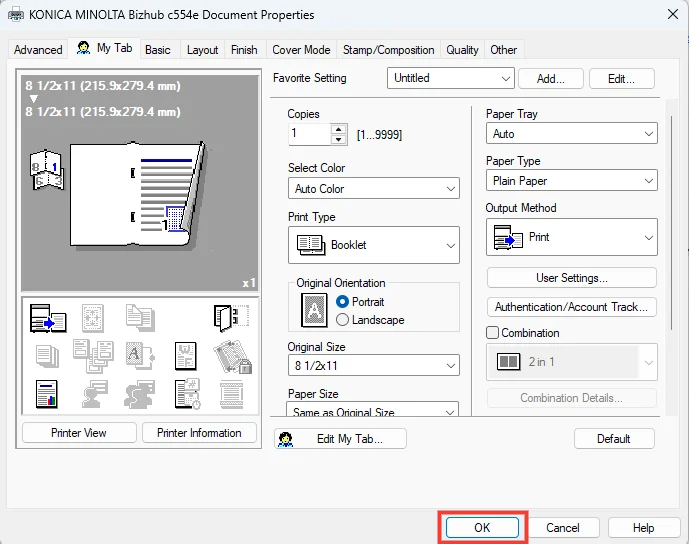
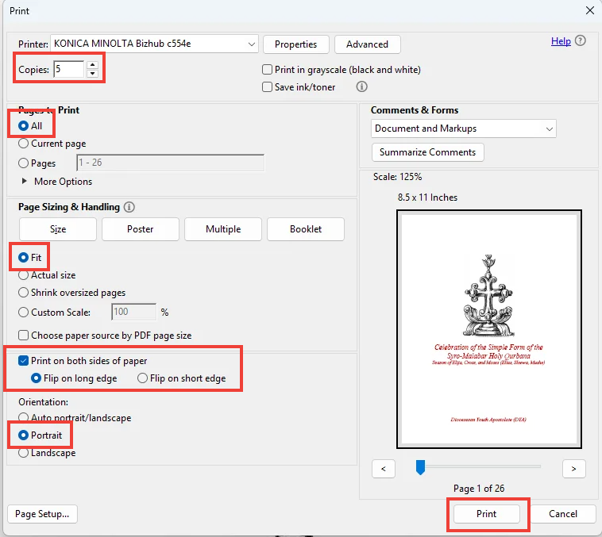

# Qurbana on Campus

This repository serves as a guide for Qurbana on Campus (QoC) and an ongoing collection of documents and resources used to create QoC booklets.

## Walkthrough of the Repository

- **`/archive`** — Contains older QoC booklets that are no longer in use.
- **`/documents`** — Contains documents and resources used to create future booklets.
- **`/photos`** — Contains images used in this README.

## Printing QoC Booklets

Follow these steps to print a QoC booklet.

### Step 1: Open the Booklet

Open File Explorer and navigate to the booklet you want to print. Open the file.

### Step 2: Open the Print Menu

Once the booklet is open, click **File** and then **Print**.

### Step 3: Open Printer Properties

In the print dialog, select **Properties** to access the printer settings.

### Step 4: Select Booklet Printing

In the printer properties window, locate the **Print Type** option.

Click the dropdown menu and select **Booklet**.

### Step 5: Enable Center Staple and Fold

Scroll down through the printer settings until you find **Center Staple and Fold**. Enable this option.

### Step 6: Confirm the Settings

Click **OK** to save your printer settings and return to the print dialog.

Make sure all the required printing options are selected, then click **Print**.

